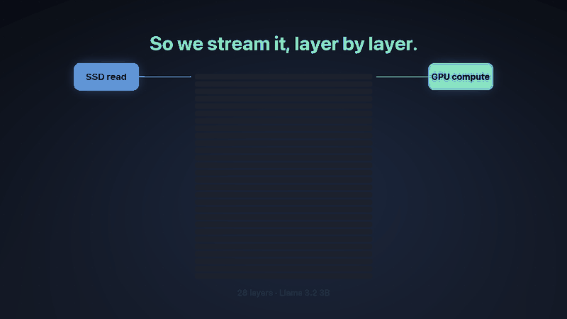
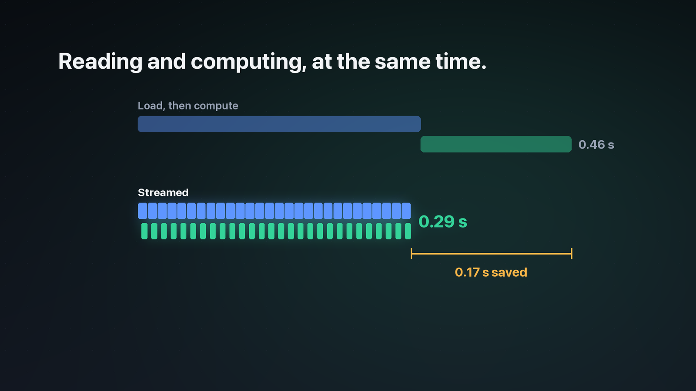

# purgekv

[](https://github.com/PoneeshKumar/purgekv/actions/workflows/lint.yml)


**Resume local LLM chats faster on Apple Silicon.** purgekv streams a saved KV cache
from SSD layer by layer, so the GPU starts computing immediately instead of waiting
for the whole cache to load.

<p align="center"></p>

| Resume a 6K-token chat from SSD (M4 MacBook, Llama 3.2 3B) | Load, then compute | **Streamed** | |
|---|---|---|---|
| 32-token new message | 0.46 s | **0.29 s** | **1.6× faster** |
| 256-token new message | 1.25 s | **0.99 s** | 1.3× faster |
| Output | | bit-identical | every resume |

### Large chats, and prefetch

Start reading the cache when the user opens the chat or starts typing, and the resume
is compute-only. Measured on the same M4 MacBook (16 GB), Llama 3.2 3B, 32-token message:

| Chat history | Today: load, then compute | Streamed | **Prefetched** | Recompute instead |
|---|---|---|---|---|
| 8K tokens | 0.54 s | 0.32 s | **0.15 s** | 27 s |
| 16K tokens | 0.96 s | 0.63 s | **0.21 s** | 62 s |
| 32K tokens | 1.80 s | 1.40 s | **0.31 s (5.8×)** | 169 s |

Llama 3.2 1B at **64K tokens**: 1.06 s → 0.80 s streamed → **0.19 s prefetched**, against
205 s to recompute. Output was identical to a never-saved cache in every run.
Details, 256-token messages and memory: [docs/RESEARCH.md](docs/RESEARCH.md#i-large-chats-8k64k-tokens-measured-researchbench_scalepy).

## Try it on your Mac

```bash
git clone https://github.com/PoneeshKumar/purgekv && cd purgekv
pip install -e .
python examples/demo.py
```

The demo builds a 6K-token chat, saves its KV cache to SSD, and resumes it three ways
with cold reads: load-then-compute, streamed, and prefetched. It prints the times and
checks that the output is identical. Bigger chats: `python research/bench_scale.py`.
Got a different Mac? [Share your numbers](https://github.com/PoneeshKumar/purgekv/issues/new?template=benchmark.yml).

To use it in your own code without cloning: `pip install git+https://github.com/PoneeshKumar/purgekv`.

## Use it

```python
from mlx_lm import load
from purgekv.segstore import SegmentKVStore
from purgekv.stream import stream_prefill, prefetch

model, tok = load("mlx-community/Llama-3.2-3B-Instruct-4bit")
store = SegmentKVStore("/path/to/kv-cache", codec="raw")   # append-only SSD tier

store.save("chat-1", cache)              # after each turn: writes only the new tokens
store.compact("chat-1")                  # optional, while idle: merge small segments
store.save_index()                       # survive a restart: SegmentKVStore.open(root)

p = prefetch(model, store, "chat-1")     # when the chat is opened / the user types
cache, logits = stream_prefill(model, store, "chat-1", new_tokens, prefetched=p)
```

**Shared prompts:** cache a long system prompt or document once, then
`store.fork("doc", "chat-7")` starts a chat from it without copying. Four chats on one
32K-token prompt used 3.9 GB of disk instead of 15.2 GB.

`codec="raw"` is lossless. `codec="q8"` halves SSD space and reads, but it is lossy:
it changed the greedy output in 3 of 6 short resumes in our tests.

## How it works



Mac LLM servers (oMLX, LM Studio's mlx-engine, vllm-mlx) resume a chat in two steps:
load the entire cache from SSD, then run the new message through the model. Time to
first token is **load + compute**.

But layer *i* only needs layer *i*'s cache, and only when the forward pass reaches
it. `stream_prefill` starts the forward pass at once. Four I/O threads read each
layer's keys and values with the page cache bypassed. The main thread hands each
layer to the GPU with `mx.async_eval`, so the GPU computes layer *i* while layer
*i + 1* is still arriving. Time to first token becomes about **max(load, compute)**.

On Apple Silicon, unified memory means the bytes read from SSD land in memory the
GPU reads directly, with no host-to-device copy to schedule. The gain is largest when
load and compute take similar time: short messages, like agent tool results and quick
replies. Long prompts are compute-bound, so the gain fades.

Layer-wise KV loading is established on NVIDIA servers (LMCache). purgekv brings it
to MLX on the Mac.

## Supported models

| | Status |
|---|---|
| Llama 3.x, Qwen3 | Supported; tested for identical output |
| Gemma 3 (sliding window), Qwen3.5 (hybrid attention) | Refused with a clear error; not yet supported |

`check_supported(model)` tells you before you start.

## Tests

```bash
pip install -e ".[dev]"
pytest                                   # fast, no model download
PURGEKV_MODEL_TESTS=1 pytest             # also runs streaming on real models
```

## The research behind it

purgekv started as an investigation into LLM memory on the Mac. Some findings:

- Keeping idle chats' KV caches in RAM pushed 3–5 GB to swap when a big app opened.
- An SSD tier that writes only new tokens cut SSD writes 7.5× against rewriting the whole cache.
- Letting the macOS kernel purge idle caches (purgeable memory) does **not** work: it deletes them before it ever signals memory pressure.

The full log, with every experiment, negative result and raw data, is in
[docs/RESEARCH.md](docs/RESEARCH.md).

## Limits

Tested on one M4 MacBook (16 GB) with the standard KV cache; Llama 3.x and Qwen3 only.

## License

MIT
